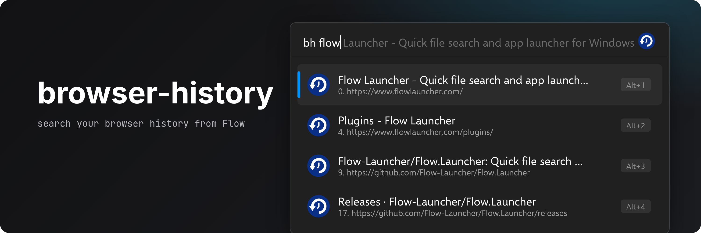

<!-- generated by readwright from docs/README.md.j2; edit the template, not this file -->


# Browser History

Search your web browser history from Flow Launcher.

[](https://github.com/Garulf/Browser-History/actions/workflows/tests.yml) [](https://github.com/Garulf/Browser-History/releases/latest) [](https://github.com/Garulf/Browser-History/releases/latest)

[](https://www.buymeacoffee.com/garulf) [](https://github.com/sponsors/Garulf)

## Features

* **Search by title or address.** `bh flow` finds every page with "flow" in its title or URL.
* **Newest first.** Results follow your history, most recent visit at the top.
* **Fully local.** Reads the browser's own history database. Nothing leaves your machine.
* **Copy the address.** `Ctrl+C` or the context menu copies a result's URL.
* **Eight browsers.** Chrome, Edge, Brave, Opera, Vivaldi, Arc, Firefox and Waterfox.

## Usage

Type `bh` followed by part of a page title or address, then press `Enter` to open it:

```
bh flow
```


The number in front of each address is its position in your history, `0` being your latest visit.

### Context menu

Open the context menu (`Shift+Enter` or right-click) on a result to open it in your browser or copy its URL:


## Installation

### Flow Launcher

In Flow Launcher, type:

```
pm install browser history
```


### Manual installation

Download `Browser-History-<version>.zip` from the [latest release](https://github.com/Garulf/Browser-History/releases/latest) and unzip it into
`%appdata%\FlowLauncher\Plugins`, then restart Flow Launcher.

Pre-releases of the next version are published from the open release PR on the
[releases page](https://github.com/Garulf/Browser-History/releases) for testing. Flow Launcher won't offer them as updates.

## Configuration

Open **Settings → Plugins → Browser History** in Flow Launcher:

| Setting | Default | Description |
| --- | --- | --- |
| Default Browser | `Chrome` | The browser whose history is searched: Chrome, Firefox, Edge, Brave, Opera, Vivaldi, Arc or Waterfox |

Chromium based browsers are read from the profile you last used, or `Default`. Firefox and
Waterfox are read from the profile they start with, as set in their `profiles.ini`.

## Requirements

* Flow Launcher 1.17.0 or newer
* Python 3.8 or newer, which Flow Launcher can install for you

## Changelog

See [CHANGELOG.md](CHANGELOG.md) for the full history.
